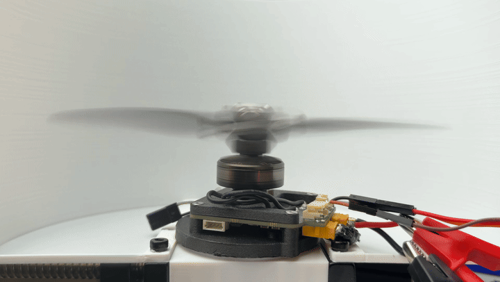

# Single Propeller Drone

A drone that flies on a single propeller, mounted on top of a finned body.

  <picture>
    <source media="(prefers-color-scheme: dark)" srcset="media/drone-dark.png">
    
  </picture>

## Test stand

  

## Firmware

- [jyjblrd/ardupilot](https://github.com/jyjblrd/ardupilot): ArduPilot fork (flight controller)
- [jyjblrd/moteus](https://github.com/jyjblrd/moteus): moteus fork (motor controller)

## Files

| Part | Fusion 360 | STEP |
| --- | --- | --- |
| Body | `body.f3z` | `body.step` |
| Prop plate | `prop plate.f3d` | `prop plate.step` |
| Propeller v1 | `prop_v1.f3d` | `prop_v1.step` |
| Propeller v2 | `prop_v2.f3d` | `prop_v2.step` |
