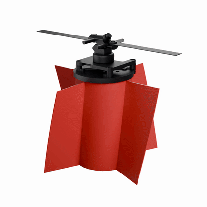

# Single Propeller Drone

A drone that flies on a single propeller, mounted on top of a finned body.

  <picture>
    <source media="(prefers-color-scheme: dark)" srcset="media/drone-dark.gif">
    
  </picture>

## Test stand

https://github.com/user-attachments/assets/4098c346-125b-4ea0-8559-b9974820a603

## Files

| Part | Fusion 360 | STEP |
| --- | --- | --- |
| Body | `body.f3z` | `body.step` |
| Prop plate | `prop plate.f3d` | `prop plate.step` |
| Propeller v1 | `prop_v1.f3d` | `prop_v1.step` |
| Propeller v2 | `prop_v2.f3d` | `prop_v2.step` |
